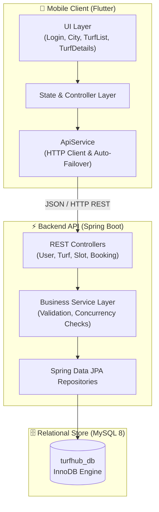
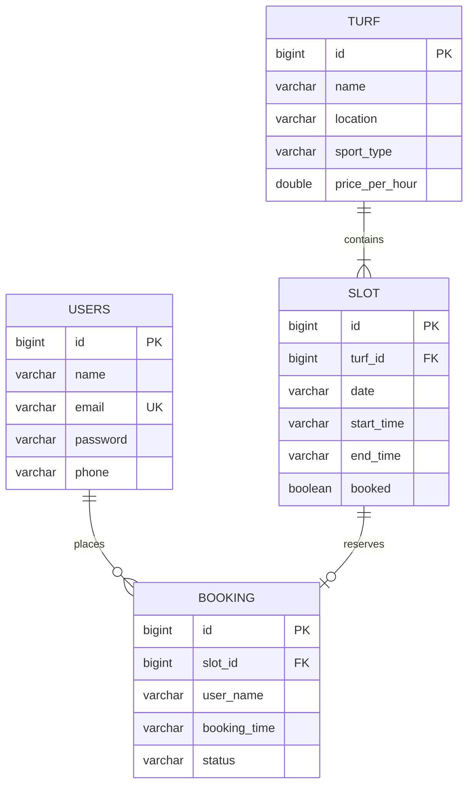

# 🏟️ TurfHub — Full-Stack Turf Booking Platform

[](https://flutter.dev/)
[](https://dart.dev/)
[](https://spring.io/projects/spring-boot)
[](https://www.oracle.com/java/)
[](https://www.mysql.com/)
[](LICENSE)

> A modern, full-stack mobile application and RESTful backend ecosystem for browsing sports turfs, scheduling time slots, and managing reservations in real time across multiple cities.

---

## 📌 Table of Contents
- [Overview](#-overview)
- [System Architecture](#-system-architecture)
- [Core Features](#-core-features)
- [Tech Stack](#-tech-stack)
- [Database Schema & ER Model](#-database-schema--er-model)
- [REST API Specifications](#-rest-api-specifications)
- [Project Directory Structure](#-project-directory-structure)
- [Getting Started](#-getting-started)
  - [Prerequisites](#prerequisites)
  - [1. Backend Setup](#1-backend-setup-spring-boot--mysql)
  - [2. Mobile App Setup](#2-mobile-app-setup-flutter)
  - [3. Running on a Physical Device](#3-running-on-a-physical-device)
- [Engineering Highlights](#-engineering-highlights)
- [Author](#-author)

---

## 🌟 Overview

**TurfHub** bridges the gap between turf managers and sports enthusiasts. It solves the real-world problem of double-booking, manual phone confirmations, and lack of slot visibility by providing an intuitive mobile client powered by a robust Spring Boot microservice and relational MySQL database.

---

## 🏗️ System Architecture



---

## ✨ Core Features

* **🔐 User Authentication**:
  - Secure user registration and login with real-time credential verification.
  - Server-side email uniqueness validation and password verification.
  - Safe client-side User models that never expose or cache sensitive credentials.

* **🏙️ Multi-City Turf Discovery**:
  - Browse turfs by city (Pune, Mumbai, Nashik, Kolhapur, Hyderabad, Nagpur, Bangalore, Delhi).
  - Strict case-insensitive filtering ensuring zero cross-city data leakage.
  - Rich turf cards displaying name, address, supported sport (Football, Cricket), and hourly rate.

* **📅 Dynamic Real-Time Slot Scheduling**:
  - Live query of available vs. booked slots for any chosen date and turf.
  - Instant status feedback indicating whether slots are open or reserved.

* **🛡️ Concurrency & Double-Booking Protection**:
  - Robust backend validation: slots are atomically marked as booked upon confirmation.
  - Prevents race conditions and duplicate bookings through transactional service boundaries.
  - Full booking lifecycle support: reserve, query by user, and cancel bookings (with automatic slot freeing).

* **📱 Modern Mobile Experience**:
  - Material 3 design system with custom green brand theme.
  - Native performance on physical Android devices.
  - Clear user feedback with contextual dialogs and error alerts.

---

## 💻 Tech Stack

### Mobile Frontend
- **Framework**: [Flutter](https://flutter.dev/) (SDK ^3.x)
- **Language**: [Dart](https://dart.dev/)
- **Networking**: `http: ^1.2.2`
- **UI Architecture**: Component-based layered architecture (`models`, `services`, `screens`)

### Backend Microservice
- **Framework**: [Spring Boot 4.1.2](https://spring.io/projects/spring-boot)
- **Language**: Java 25
- **ORM / Persistence**: Spring Data JPA / Hibernate
- **Database Driver**: MySQL Connector/J
- **Build Tool**: Apache Maven (`mvnw`)
- **API Style**: RESTful JSON with standardized `ResponseEntity<T>` responses

### Database
- **Engine**: MySQL 8.x
- **Schema Name**: `turfhub_db`
- **Dialect**: `org.hibernate.dialect.MySQLDialect`

---

## 🗄️ Database Schema & ER Model



---

## 📡 REST API Specifications

### 1. Authentication Endpoints (`/api/users`)
| Method | Endpoint | Request Body | Description |
| :--- | :--- | :--- | :--- |
| `POST` | `/api/users/register` | `{ "name", "email", "password", "phone" }` | Registers a new user. Returns 400 if email exists. |
| `POST` | `/api/users/login` | `{ "email", "password" }` | Authenticates user and returns profile (id, name, email, phone). |

### 2. Turf Endpoints (`/api/turfs`)
| Method | Endpoint | Request Body | Description |
| :--- | :--- | :--- | :--- |
| `GET` | `/api/turfs` | — | Retrieves all registered turfs. |
| `GET` | `/api/turfs/{id}` | — | Retrieves details for a specific turf by ID. |
| `POST` | `/api/turfs` | `{ "name", "location", "sportType", "pricePerHour" }` | Adds a new turf facility. |

### 3. Slot Endpoints (`/api/slots`)
| Method | Endpoint | Request Body | Description |
| :--- | :--- | :--- | :--- |
| `GET` | `/api/slots/turf/{turfId}` | — | Retrieves all slots for a turf. |
| `GET` | `/api/slots/turf/{turfId}/available` | — | Retrieves only unbooked slots for a turf. |
| `POST` | `/api/slots` | `{ "turf": {"id": 1}, "date", "startTime", "endTime", "booked": false }` | Creates a new time slot. |

### 4. Booking Endpoints (`/api/bookings`)
| Method | Endpoint | Request Body | Description |
| :--- | :--- | :--- | :--- |
| `POST` | `/api/bookings` | `{ "slot": {"id": 1}, "userName": "Shreyas" }` | Reserves a slot. Fails if slot is already booked. |
| `GET` | `/api/bookings/user/{userName}` | — | Retrieves all bookings for a user. |
| `DELETE` | `/api/bookings/{id}` | — | Cancels booking and frees up the associated slot. |

---

## 📂 Project Directory Structure

```text
TurfHub/
├── backend/                               # Spring Boot Application
│   ├── src/
│   │   ├── main/
│   │   │   ├── java/com/turfhub/turfhub_backend/
│   │   │   │   ├── controller/            # REST Endpoints (User, Turf, Slot, Booking)
│   │   │   │   ├── model/                 # JPA Entities (User, Turf, Slot, Booking)
│   │   │   │   ├── repository/            # Spring Data JPA Interfaces
│   │   │   │   ├── service/               # Business Logic & Validation
│   │   │   │   └── TurfhubBackendApplication.java
│   │   │   └── resources/
│   │   │       └── application.properties # Datasource & Port Configurations
│   │   └── test/                          # Unit and Integration Tests
│   ├── mvnw / mvnw.cmd                    # Maven Wrapper
│   └── pom.xml                            # Project Dependencies
│
├── mobile/                                # Flutter Client
│   ├── android/                           # Native Android Configurations & Manifest
│   ├── assets/                            # Images, Icons, and Media
│   ├── lib/
│   │   ├── models/                        # Client Data Models (Turf, Slot, User)
│   │   ├── services/                      # ApiService (HTTP Client & Base URL routing)
│   │   └── main.dart                      # UI Entrypoint, Theming & Screen Navigation
│   └── pubspec.yaml                       # Dependencies & Flutter Config
│
├── .gitignore                             # Monorepo Version Control Rules
└── README.md                              # Project Documentation
```

---

## 🚀 Getting Started

### Prerequisites
- **Java**: JDK 17 or JDK 21+ (Compatible with Java 25)
- **Maven**: 3.8+ (or use included `mvnw`)
- **MySQL**: 8.0+
- **Flutter**: 3.24+
- **Android SDK**: API 34/35 with an emulator or physical device

---

### 1. Backend Setup (Spring Boot & MySQL)

1. **Configure MySQL**:
   Open MySQL Workbench or CLI and ensure MySQL is running on `localhost:3306`:
   ```sql
   CREATE DATABASE IF NOT EXISTS turfhub_db;
   ```

2. **Update Database Credentials**:
   Edit `backend/src/main/resources/application.properties`:
   ```properties
   spring.datasource.url = jdbc:mysql://localhost:3306/turfhub_db?createDatabaseIfNotExist=true&allowPublicKeyRetrieval=true&useSSL=false
   spring.datasource.username = YOUR_MYSQL_USER
   spring.datasource.password = YOUR_MYSQL_PASSWORD
   server.port = 8080
   ```

3. **Start the Backend**:
   ```bash
   cd backend
   ./mvnw spring-boot:run
   ```
   The server will start on `http://localhost:8080`. Verify by opening `http://localhost:8080/api/hello`.

---

### 2. Mobile App Setup (Flutter)

1. **Install Dependencies**:
   ```bash
   cd mobile
   flutter pub get
   ```

2. **Run on Emulator or Browser**:
   ```bash
   flutter run
   ```

---

### 3. Running on a Physical Device

When debugging on a physical Android phone connected via USB:

1. **Enable USB Debugging** on your phone (under Developer Options).
2. **Reverse the Port Mapping** via ADB so the phone communicates directly with your laptop's local Spring Boot instance:
   ```bash
   adb reverse tcp:8080 tcp:8080
   ```
3. Run the app:
   ```bash
   flutter run
   ```
   The app will automatically route requests via `http://127.0.0.1:8080`.

---

## 💡 Engineering Highlights

- **Clean Layered Architecture**: Strictly separates presentation (Flutter Widgets), business logic (`Services`), and data access (`Repositories`), ensuring testability and modularity.
- **Failover-Ready Networking**: Mobile `ApiService` includes dynamic host fallbacks for localhost and local LAN IPs for seamless physical device testing.
- **Database Normalization**: Normalized tables with foreign-key referential integrity (`@ManyToOne` bindings) preventing orphaned bookings or corrupted slot states.
- **Security-First Model Separation**: Sensitive attributes like user passwords are never included in API responses or stored inside Flutter client-side state models.

---

## 👨‍💻 Author

**Shreyas Gadekar**
- GitHub: [@ShreyasGadekar9](https://github.com/ShreyasGadekar9)
- Email: gadekarshreyas99@gmail.com

---

## 📄 License
This project is licensed under the MIT License — see the [LICENSE](LICENSE) file for details.
