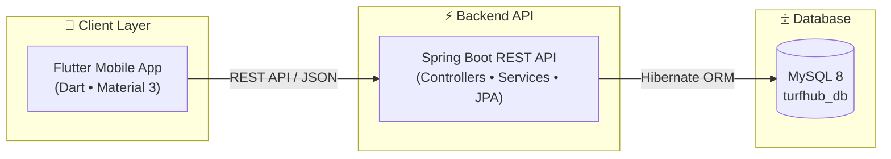

# 🏟️ TurfHub

[](https://flutter.dev/)
[](https://dart.dev/)
[](https://spring.io/projects/spring-boot)
[](https://www.oracle.com/java/)
[](https://www.mysql.com/)

> A full-stack sports turf booking platform built with **Flutter**, **Spring Boot**, and **MySQL**.

---

### 🏗️ System Architecture



---

### ✨ Features
- **User Authentication**: Secure user registration and login.
- **Multi-City Discovery**: Browse turfs filtered by city (Pune, Mumbai, Nashik, Kolhapur, etc.).
- **Live Slot Booking**: View real-time slot availability and reserve slots instantly.
- **Double-Booking Protection**: Transactional backend checks prevent duplicate slot reservations.

---

### 📡 API Overview
| Method | Endpoint | Description |
| :--- | :--- | :--- |
| `POST` | `/api/users/register` | Register new user |
| `POST` | `/api/users/login` | Authenticate user |
| `GET` | `/api/turfs` | Fetch all turfs |
| `GET` | `/api/turfs/{turfId}/slots/available` | Fetch available slots for a turf |
| `POST` | `/api/bookings` | Book a time slot |
| `PUT` | `/api/bookings/{id}/cancel` | Cancel booking and release slot |

---

### 🚀 Quick Start

#### 1. Backend (Spring Boot)
Ensure MySQL is running, then start the server:
```bash
cd backend
./mvnw spring-boot:run
```
> Server runs on `http://localhost:8080`.

#### 2. Mobile App (Flutter)
```bash
cd mobile
flutter pub get

# If testing on physical Android device over USB:
adb reverse tcp:8080 tcp:8080

flutter run
```

---

### 👤 Author
**Shreyas Gadekar**
- GitHub: [@ShreyasGadekar9](https://github.com/ShreyasGadekar9)
- Email: gadekarshreyas99@gmail.com
